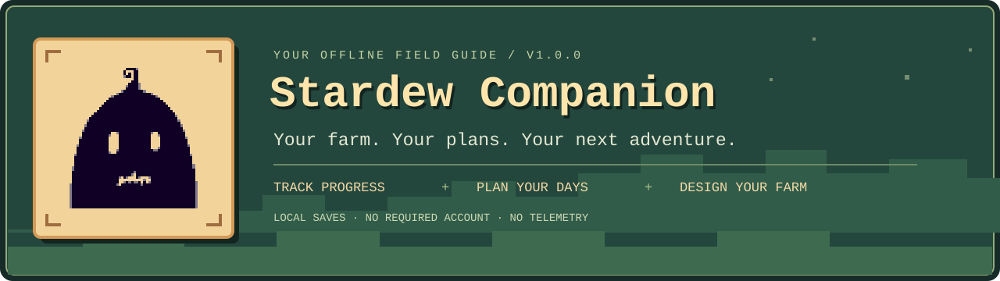
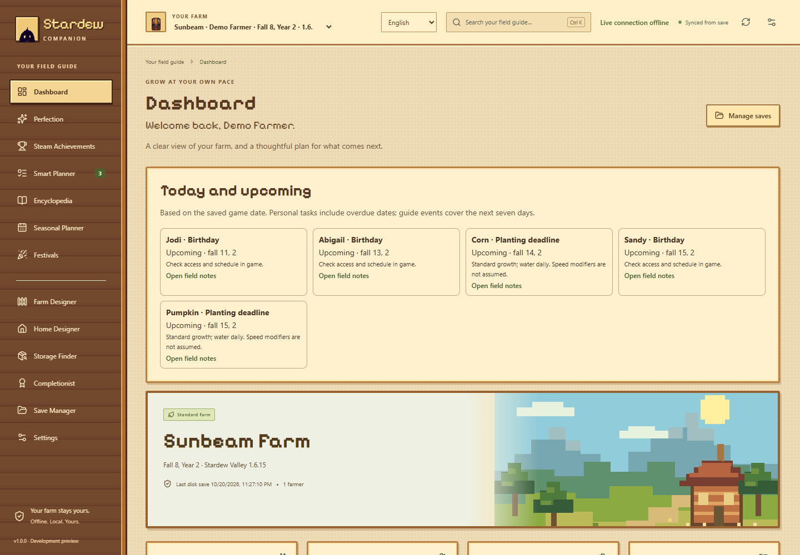
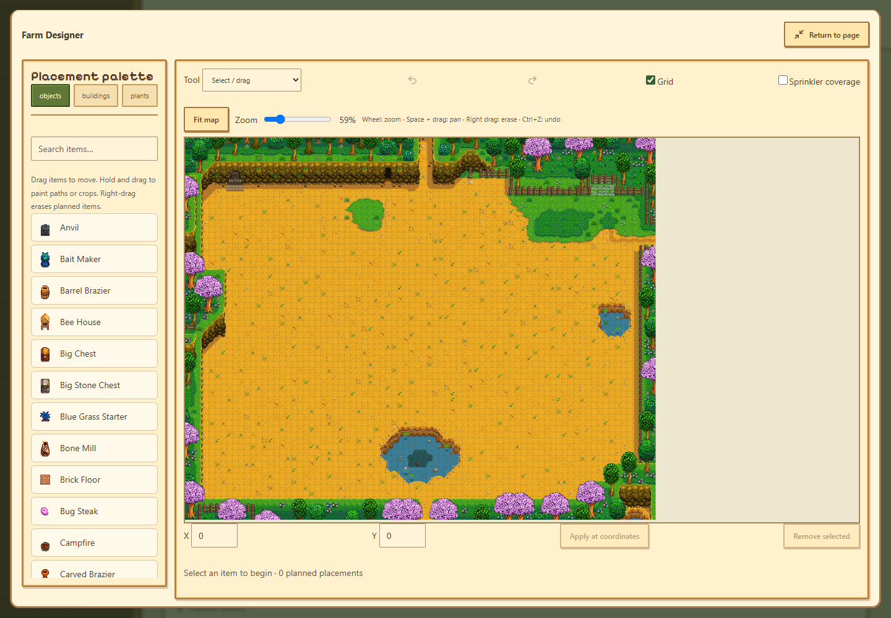
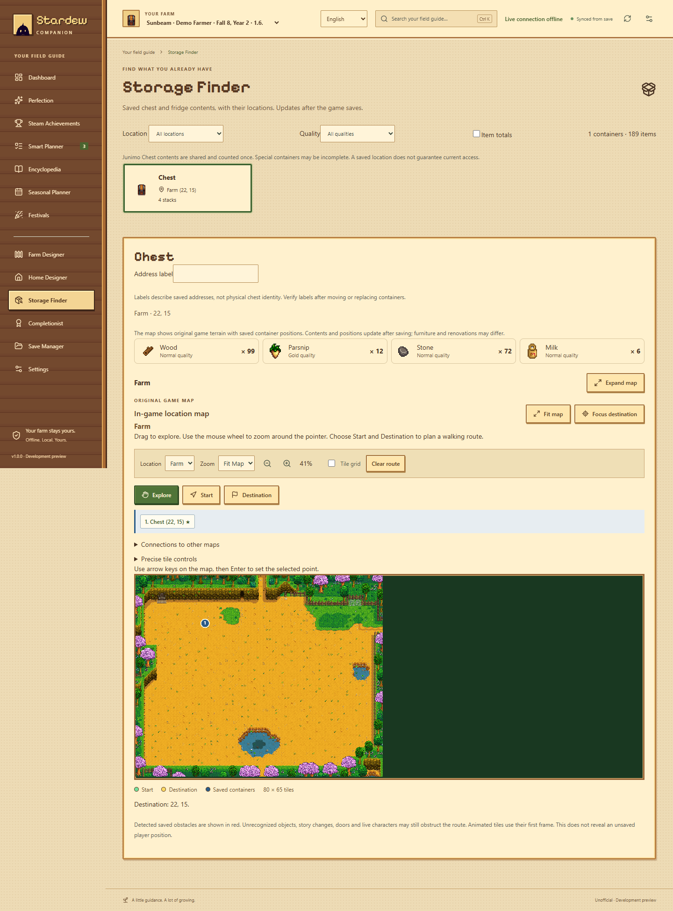

<p align="center">
  
</p>

<p align="center">
  <strong>A cozy desktop companion for a very busy farmer.</strong><br />
  Understand your save, find what is missing, plan your next day, and design a farm you love.
</p>

<p align="center">
  <a href="https://github.com/abisumbra/stardew-companion/releases/tag/v1.0.0"></a>
  
  
  <a href="LICENSE"></a>
</p>

<p align="center">
  <a href="https://github.com/abisumbra/stardew-companion/releases/tag/v1.0.0"><strong>Download 1.0.0</strong></a> ·
  <a href="#features">Explore the features</a> ·
  <a href="https://github.com/abisumbra/stardew-companion/issues">Report an issue</a>
</p>

---

## 🌱 Meet your new farm companion

Stardew Companion turns your local **Stardew Valley save** into a practical field guide: what you have completed, what is still missing, where to find it, and which materials to prepare next. Alongside progress tracking, it brings together a goal planner, illustrated encyclopedia, seasonal agenda, farm and home designers, and a searchable view of your saved storage.

- **Start with your own farm.** Automatically discover saves and switch between farmers and farms.
- **Make progress with a plan.** Turn missing recipes, fish, collections and upgrades into actionable goals.
- **Keep useful knowledge close.** Browse gifts, schedules, festivals, fishing conditions, monsters and more.
- **See before you place.** Lay out your farm and home in dedicated design workspaces.
- **Keep your data local.** No required account, telemetry or save uploads.

> **Release scope:** 1.0.0 is available for Windows x64. Packages are unsigned and the project remains under active development. Save analysis is read-only; optional game-journal transfers and the bundled game connection are separate, explicit actions. See [compatibility and limits](#compatibility).

## 📸 A look inside

<p align="center">
  
  <br /><sub>Your farm, daily opportunities and next steps in one place.</sub>
</p>

| Plan your layout | Find your supplies |
| :---: | :---: |
|  |  |
| Eight vanilla farm layouts, placement tools and saved designs. | Search saved chests, inspect contents and locate materials. |

<sub>Actual application screens with synthetic farm/player data and locally loaded game artwork. Screenshots illustrate the interface, not a real player's progress. Stardew Valley artwork belongs to ConcernedApe.</sub>

<a id="features"></a>

## 🧭 Everything in your field guide

### 🏡 01 · Dashboard & daily agenda

- See the selected farm, farmer, game version, in-game date and last synchronization.
- Review progress and jump directly into missing collection entries or useful next steps.
- Find upcoming birthdays, festivals, seasonal fish opportunities and planting deadlines.
- Keep personal tasks tied to the in-game calendar, including recurring tasks.
- Use **Seasonal Planner** to switch seasons, browse missing fish, inspect crop calendars and prepare birthday gifts; future weather remains unknown.
- Switch farms without mixing their plans or saved state.

### ✨ 02 · Perfection & collection progress

- Inspect **11 Perfection criteria** with evidence from the save rather than assumptions.
- Track shipping, cooking, crafting, fishing, friendship and other supported requirements.
- For vanilla 1.6, use catalogs covering **154 shipping entries, 81 dishes, 149 craftables and 72 fish**; the Wedding Ring is excluded from the craftable total.
- Name missing entries individually and filter completed, incomplete and unknown states.
- Keep recipe knowledge, item ownership and completed actions separate: owning a dish does not prove it was cooked.
- Handle version-specific 1.5/1.6 rules, supported multiplayer evidence and separate waiver points. Unsupported or absent information remains unknown.

### 🏆 03 · Steam achievement companion

- Browse the observed **49-achievement official Steam catalog** with guidance and farm evidence.
- Separate Steam unlocks, save-derived requirements and manual confirmations.
- Optionally verify a public Steam profile and download official achievement icons for offline reuse.
- Filter completed, incomplete and unknown entries without treating unavailable evidence as failure.
- Keep Steam interaction read-only: Companion does not unlock or write achievements to your account.

### 📋 04 · Smart Planner & material preparation

- Build a farm-specific goal list from cooking, crafting, shipping, fishing, buildings and supported collection tasks.
- Pin goals, assign priorities, reserve resources and keep personal/manual steps.
- Expand intermediate recipes into shared prerequisites and raw materials.
- Account for deterministic machine inputs, fuel, output yields and applicable farmer professions.
- Use the selected farmer's inventory and supported saved storage, counting the shared Junimo pool once.
- Review missing materials, acquisition alternatives and readable next actions.
- Jump from a required material to Storage Finder to look for matching supplies.
- Reconcile supported completion evidence after a later scan, including progress made while Companion was closed.

### 🔌 05 · Optional game connection & journal tasks

- Launch the supported game through Companion using its bundled connection; a separate SMAPI/mod installation is not required.
- Observe supported action counters and synchronize measurable Companion goals with the in-game journal.
- Remove completed zero-reward Companion tasks without extra rewards or quest credit.
- Review connection state, last communication, transfer previews and saved outcomes.
- Use backed-up, explicit game-closed journal transfers where supported, with unchanged-save undo.
- Keep manual and unmeasurable goals explicit rather than inventing completion.

**Connection scope:** Windows, vanilla Stardew Valley **1.6.15**, single-player. Live evidence stays separate from saved evidence. The connection can change game memory; normal saving remains the game's responsibility. [Connection guide →](docs/CONNECTION_DESIGN_STORAGE.md)

### 🗺️ 06 · Farm Designer

- Work with **all eight vanilla layouts**: Standard, Riverland, Forest, Hill-top, Wilderness, Four Corners, Beach and Meadowlands.
- Browse object, building and crop palettes on original game maps.
- Place, paint, drag, erase and edit coordinates with zoom, pan, fit and an expanded workspace.
- Use undo/redo, one-stroke painting undo, multiple selection, area selection and group movement/copying.
- Hide or lock layers and move selected items with the keyboard.
- Save design libraries, recover limited history/trash and import or export individual design files.
- Preview guarded transfers for supported one-tile objects and existing-object moves.

**Transfer boundary:** building and crop layouts remain design-only. Supported transfers use guarded inventory/recipe rules; this is not unrestricted world editing. [Design controls and limits →](docs/DESIGN_WORKSPACE.md)

### 🪑 07 · Home Designer

- Plan furniture in **six base home templates**, including upgraded homes, spouse-room variants and the cellar.
- Search installed furniture by type and use its native footprint and artwork.
- Place rugs beneath furniture and use the shared zoom, pan and editing controls.
- Keep a separate home-design library with recovery and portable design files.

**Home designs stay inside Companion.** Furniture transfer/rotation, renovation reconstruction, wallpaper and flooring editing are not implemented.

### 📦 08 · Storage Finder

- Search saved chests, fridges and supported containers by item.
- Inspect item totals, stack quantities, quality and selected-farmer inventory separately.
- See saved container coordinates on supported original exterior/interior maps.
- Follow actual building links for interior identities and show readable building addresses.
- Label containers locally and highlight matching items.
- Count shared Junimo contents once; do not silently confirm unsupported or invalid container data.

**Storage reflects the last game save**, not live inventory. Labels follow container addresses and should be checked after moving a chest.

### 📚 09 · Offline encyclopedia & item reference

- Search **77 bundled guides**, supplemented by supported installed-data guides for recipes, crops, forage, buildings and machines.
- Explore ingredients, unlock requirements, acquisition routes and preparation steps.
- Browse objects, machines, tools, weapons, hats, boots, shirts, pants, trinkets and furniture.
- View original portraits, animal sprites, building previews and supported monster variants.
- Compare supported quality/sell-price values, professions and ingredient-dependent artisan pricing.
- Follow source links and distinguish installed-game data from authored guidance.

### 🎣 10 · Fishing, maps & exploration

- Filter fish by season, region and method.
- Read each route's time windows, weather, fishing level and access requirements.
- Plan Crab Pot catches and Magic Bait routes separately.
- Explore Valley/Island references, seasonal map textures, region highlights and focus controls.
- Use coordinates, zoom, grids and static walking routes on supported location maps.

Map markers and static routes are references; they do not prove that a region is unlocked, a tile is fishable or a live path is clear.

### 💜 11 · Villagers, gifts & combat guides

- Browse villager portraits, saved heart progress, relationship caps and locked heart slots.
- Check **34 birthdays** and five gift preference classes.
- Inspect selected-farmer talk/gift counters when present in the save.
- Read **31 installed schedules** with stops linked to map coordinates.
- Review monster profiles, reference locations/floor bands, loot rolls and combat advice.
- Track saved eradication targets and associated rewards.

### 🎪 12 · Festivals & the completionist's checklist

- Explore **12 illustrated festival guides** with preparation tasks, shopping/contest advice and year-specific map references.
- Inspect museum donations, saved/remixed Community Center bundles and offering choices.
- Review **130 Golden Walnuts across 69 evidence groups**, with collection hints that may contain spoilers.
- Inspect saved quest journals and add supported collection objectives to the planner.
- Keep these extra collections distinct from official Perfection and Steam account unlocks.

### 💾 13 · Save Manager, recovery & personalization

- Discover saves automatically, add custom directories or import a full save file.
- Watch for completed save writes with stable-read retries and clear synchronization errors.
- Keep plans, preferences, designs and progress summaries in local SQLite storage.
- Export application backups, preview a selective restoration and undo the latest restore through its recovery record.
- Recover individual sections after an error and export sanitized diagnostics.
- Choose among **12 interface languages**, adjust text size and use visible keyboard focus/navigation.

English/Turkish coverage is broader; other languages and long guides remain partially translated, with English fallbacks. Twelve selectable languages does not mean twelve complete translations.

## 🚀 Download & start farming

| Package | Best for | Download |
| --- | --- | --- |
| **Windows installer** | Normal installation and desktop shortcut | [Download setup.exe](https://github.com/abisumbra/stardew-companion/releases/download/v1.0.0/Stardew-Companion-1.0.0-x64-setup.exe) |
| **Windows ZIP** | Running without an installer | [Download ZIP](https://github.com/abisumbra/stardew-companion/releases/download/v1.0.0/Stardew-Companion-1.0.0-windows-x64.zip) |
| **SHA-256 checksums** | Checking download integrity | [View checksums](https://github.com/abisumbra/stardew-companion/releases/download/v1.0.0/SHA256SUMS-1.0.0.txt) |

1. Install the Windows package, or extract the **whole ZIP** into a folder. Microsoft Edge WebView2 is required.
2. Open Companion and choose your farm. If no save appears, use **Save Manager** to add its directory or import the full `FarmerName_ID` file.
3. If original artwork is missing, open **Settings → Original game artwork → Choose game folder** and select the Stardew Valley folder containing `Content`.
4. Start with **Dashboard**, add a goal in **Smart Planner**, or open a design workspace.

> The ZIP avoids installation but still uses Windows app-data for saved settings and plans. It is not a self-contained portable-data mode. A normal save scan reads the latest completed disk save; save your day in game and refresh to see new progress.

## 🛡️ Local by default

| Area | Behavior |
| --- | --- |
| **Save scanning** | Read-only XML analysis; no save uploads. |
| **Application data** | Local SQLite, typically `%APPDATA%\com.stardewcompanion.app` on Windows. |
| **Accounts & telemetry** | No required account, telemetry or analytics. |
| **Optional internet access** | Explicit public Steam reads, achievement-icon downloads and source links. |
| **Original artwork** | Primarily decoded from your installed game; the Krobus icon and documentation screenshots are included project assets. |
| **Game changes** | Explicit supported journal transfers or optional live connection; separate from scanning. |

<a id="compatibility"></a>

## 🧩 Compatibility and current limits

| Component | Current scope |
| --- | --- |
| **Distributed package** | Windows x64 1.0.0; unsigned. |
| **Save analysis** | Version-aware vanilla 1.5/1.6 catalogs; unknown/unsupported evidence is marked. |
| **Installed artwork/data** | Supported Stardew Valley 1.6+ installation; Steam libraries are detected, custom folders can be selected. |
| **Bundled live connection** | Windows vanilla 1.6.15, single-player. |
| **Linux/macOS** | Build/CI configuration exists; native runtime validation is pending. |
| **Mods** | Mod-adjusted totals, SMAPI virtual assets and all modded maps/containers are not guaranteed. |

Additional boundaries:

- No automatic Steam achievement writes or complete tracking of every story/event condition.
- No guaranteed live weather, NPC positions, equipment state or unlocked-area detection.
- No furniture transfer/rotation, renovation reconstruction, wallpaper/flooring editing, or building/crop transfer.
- No reconstruction of every prismatic animation, player dye, procedural variant or generated mine floor.
- Static paths cannot account for live objects, doors, NPCs or generated terrain.
- Full guide translation, cross-platform runtime checks and a complete real-game playthrough remain unfinished.

Read the [current validation record](DEVELOPMENT_STATUS.md) and [latest implementation report](docs/0.12-WORKLOG.md) before relying on a particular feature. The 1.0.0 release is a versioned development build, not a claim that every feature is complete.

## 🛠️ For developers

<details>
<summary><strong>Set up, run and build from source</strong></summary>

### Requirements

- Node.js 24.7+ and npm.
- Rust stable.
- .NET SDK 9 to build the bundled `net6.0` connection; a .NET 6 runtime for bridge tests.
- [Tauri platform prerequisites](https://v2.tauri.app/start/prerequisites/); on Windows, MSVC C++ tools and WebView2.

```sh
git clone https://github.com/abisumbra/stardew-companion.git
cd stardew-companion
npm ci
npm run tauri dev
```

`npm run dev` runs the browser preview; native save access requires Tauri. Close another server on port 1420 before starting Tauri.

Build a Windows installer:

```sh
npm run tauri -- build --bundles nsis
```

Output: `src-tauri/target/release/bundle/nsis/`. MSI can be configured with `--bundles msi` when its prerequisites are present.

### Checks

```sh
npm run check
npm run locale:check
npm run test:e2e
npm run bridge:build
dotnet run --project bridge/tests/Bridge.Tests.csproj -c Release
cargo test --manifest-path src-tauri/Cargo.toml --locked
cargo fmt --manifest-path src-tauri/Cargo.toml --check
cargo clippy --manifest-path src-tauri/Cargo.toml --all-targets --locked -- -D warnings
```

The local 1.0.0 verification recorded **136 frontend/domain + 41 native unit + 25 parser tests** passing. Browser tests use synthetic saves and IPC mocks; this is separate from real-game and installer validation. See the development log for broader historical test results and their limits.

### Project map

| Path | Purpose |
| --- | --- |
| `src/` | React interface, TypeScript domain logic and localization. |
| `src-tauri/` | Rust desktop integration, save parsing, storage, artwork decoding and packaging. |
| `bridge/` | Optional .NET game connection and its tests. |
| `data/` | Versioned catalogs, reference data and applicable knowledge licenses. |
| `docs/` | Usage guides, design controls and verification reports. |
| `e2e/` | Browser tests with synthetic data. |
| `scripts/` | Localization, data tooling and local verification utilities. |

**Stack:** Tauri 2 · React 19 · TypeScript · Rust · SQLite · .NET/Harmony · Vite · Vitest · Playwright.

</details>

<details>
<summary><strong>Save locations and troubleshooting</strong></summary>

| Platform | Default save location |
| --- | --- |
| Windows | `%APPDATA%\StardewValley\Saves` |
| Linux/macOS | `~/.config/StardewValley/Saves` |
| Proton | Steam library → `steamapps/compatdata/413150/pfx/drive_c/users/steamuser/AppData/Roaming/StardewValley/Saves` |

- **No saves?** Add the correct folder or import the full save, not `SaveGameInfo` or an `_old` backup.
- **Save changing or invalid XML?** Finish the in-game overnight save and rescan. Companion retains the last good snapshot after a failed refresh.
- **Missing artwork?** Select the game folder in Settings and reload artwork after game updates.
- **Unknown progress?** Check the evidence panel; unavailable information is not counted as complete.
- **Missing materials?** Check the selected farmer and supported storage. Other farmers' bags and unsupported containers are excluded.
- **Database error?** Ensure Companion's own app-data directory is writable. Game folders only need read access for scanning.

</details>

## 📖 Documentation & contributing

| Read about… | Open |
| --- | --- |
| Architecture and data flow | [Architecture](ARCHITECTURE.md) |
| Current verification and unfinished work | [Development status](DEVELOPMENT_STATUS.md) |
| Changes by version | [Changelog](CHANGELOG.md) |
| Game connection, design transfers and storage | [Connection guide](docs/CONNECTION_DESIGN_STORAGE.md) |
| Farm/home editing tools | [Design workspace](docs/DESIGN_WORKSPACE.md) |
| Planner actions and localization | [Workflow guide](docs/WORKFLOW_AND_LOCALIZATION.md) |
| Knowledge sources and permitted imports | [Data sources](DATA_SOURCES.md) · [Import guide](docs/KNOWLEDGE_IMPORT.md) |
| Translation contributions | [Localization](src/locales/README.md) |
| Bugs, changes and contribution workflow | [Contributing](CONTRIBUTING.md) · [Issues](https://github.com/abisumbra/stardew-companion/issues) |

## 🌾 Credits & licenses

An **unofficial fan project**, with no endorsement by ConcernedApe or Valve.

- Original application code and original interface artwork: [MIT](LICENSE).
- Applicable wiki-derived knowledge: [CC BY-NC-SA 3.0](data/LICENSE.md), including its noncommercial/share-alike conditions.
- Stardew Valley, Krobus, game artwork and portraits belong to **ConcernedApe**; they are not relicensed under MIT.
- Steam assets and third-party libraries retain their owners' rights and licenses. [Full notices →](THIRD_PARTY_NOTICES.md)

---

<p align="center"><strong>One more goal. One more season. A little more room to enjoy your farm.</strong><br /><a href="https://github.com/abisumbra/stardew-companion/releases/tag/v1.0.0">Get Stardew Companion 1.0.0</a></p>
